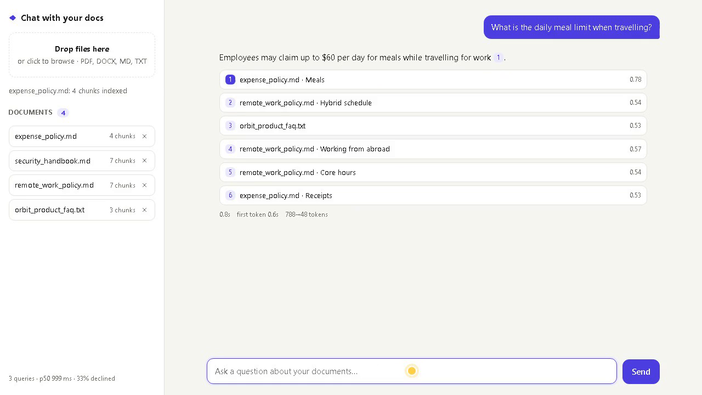
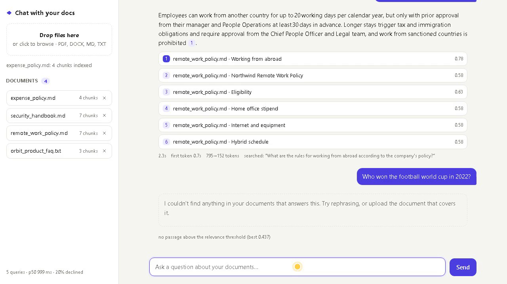
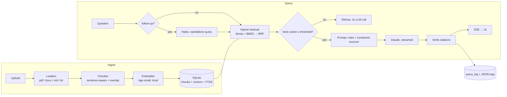

# Chat With Your Docs

Upload PDFs, Word, Markdown or text files and ask questions. Answers are grounded in your documents, streamed, and carry numbered citations you can click to see the exact passage. If the documents don't contain the answer, the app says so instead of guessing.

> Assignment option 1 (RAG over a document collection). FastAPI + a no-build vanilla JS UI, hybrid retrieval over SQLite, and a swappable LLM (Anthropic, or any OpenAI-compatible API such as Groq or xAI).





A short walkthrough video accompanies the submission email.

## Quick start

```bash
python -m venv .venv && source .venv/bin/activate      # Windows: .venv\Scripts\activate
pip install -r requirements-dev.txt
cp .env.example .env                                   # add XAI_API_KEY (Grok) or ANTHROPIC_API_KEY
uvicorn app.main:app_factory --factory --port 8000     # open http://localhost:8000
```

For a quick demo, upload the files in `sample_docs/` (or `curl -X POST localhost:8000/api/samples` to index them in one go). First run downloads the embedding model (~130 MB, cached).

LLM provider is chosen by which key you set (`LLM_PROVIDER=auto`): `XAI_API_KEY` → any OpenAI-compatible endpoint via `XAI_BASE_URL` (xAI Grok by default; I tested with Groq), `ANTHROPIC_API_KEY` → Claude. Set `LLM_PROVIDER=xai` to force one when both are present.

No API key? It still runs in *retrieval-only mode* (shows the best passages instead of a written answer), which is how I developed and tested the retrieval stack.

Hosting: the image listens on `$PORT` (7860) and the README header above makes the repo a ready-made Hugging Face Docker Space. Set `XAI_API_KEY` (or `ANTHROPIC_API_KEY`) as a secret, and `ACCESS_PASSWORD` to put the demo behind a password. The sample documents are re-indexed on every boot (`LOAD_SAMPLES_ON_START`) because a free Space's disk is wiped on restart.

Docker: `docker compose up --build` (the embedding model is baked into the image).

> The image has not been built on my machine yet (Docker wasn't running while I wrote it), so treat the Dockerfile as untested until it has been built once.

```bash
pytest                              # 26 tests, offline, ~5 s (fake LLM + hash embedder)
python -m eval.run_eval --sweep     # retrieval quality on the golden set (real embedding model)
python -m eval.run_eval --answers   # + end-to-end answer check (needs API key)
```

## Architecture



| Module | Responsibility |
|---|---|
| `loaders.py`, `chunking.py`, `ingestion.py` | bytes → sections (page/heading kept) → chunks → vectors → store |
| `store.py` | SQLite: documents, chunks, float32 vectors, FTS5 index, query log |
| `retrieval.py` | dense + BM25, Reciprocal Rank Fusion, confidence signal |
| `prompts.py`, `llm.py` | prompt templates; Anthropic client behind a tiny interface |
| `rag.py` | the pipeline as a generator of UI events; guardrails and tracing |
| `main.py`, `static/` | REST + SSE API, single-page UI |

## RAG / LLM decisions

For each choice: what I considered → what I picked → why.

**Generation LLM — pluggable: Grok (`grok-4`, via xAI's OpenAI-compatible API) or Claude (`claude-opus-5-5`, effort `low`).** Both sit behind a two-method `LLM` interface (`rewrite`, `stream_answer`) in `llm.py`; adding another provider is one class. The paragraph below was written around Claude; the same reasoning applies to whichever model you configure. Alternatives: GPT-class models, open-weights via Ollama. I picked Claude because instruction-following on "answer only from these sources, cite them, otherwise say you can't" is the whole product here, and I wanted prompt-injection resistance. Effort is `low` because grounded QA is extraction + synthesis, not reasoning, and effort is the main latency/cost dial. The model is an env var. **Honest caveat:** the default models are probably more model than this task needs; the evidence-based move is to run `eval --answers` against Sonnet/Haiku-class models and take the cheapest one that holds citation accuracy. I haven't done that sweep.

**Query rewriting — a small model (`claude-haiku-5-5`), only on follow-ups.** "And from abroad?" is useless as a search query. A cheap model condenses history + question into a standalone query. First turns skip it (no extra call), and if the call fails we fall back to the raw question rather than fail the turn.

**Embeddings — `BAAI/bge-small-en-v1.5` via fastembed (ONNX, local).** Alternatives: OpenAI/Voyage/Cohere APIs, larger bge/e5 models. Local means no second vendor or API key, no per-token cost, no document text leaving the machine for embedding, and no torch in the image. 384 dims, strong for its size. Trade-off: English-centric, and lower ceiling than the best hosted models. Swappable behind the `Embedder` protocol.

**Vector store — SQLite + in-memory numpy matrix, with FTS5 for BM25.** Alternatives: Chroma, Qdrant, pgvector. For thousands of chunks, brute-force cosine is sub-millisecond, and SQLite gives me vectors, metadata, keyword search, transactions and persistence in one file with zero infrastructure. It also lets me do hybrid search without bolting on a second system. This will not scale past ~100k–1M chunks (see "Productionizing").

**Orchestration — plain Python, no LangChain/LlamaIndex.** The pipeline is six steps in one 150-line file. A framework would hide exactly the parts (prompting, thresholds, tracing) I want to be able to read, test and change. I'd reconsider for agentic/multi-step flows.

**Chunking — sentence-aware packing, ~900 chars (~200 tokens), 150 chars overlap, never across sections.** Small enough that a chunk is about one idea (better precision, less noise in the prompt), big enough to hold a full policy clause. Page numbers and markdown/docx headings travel with each chunk and are used for citations. Each chunk is embedded with a `document > heading` header so "20 days" under *Working from abroad* is distinguishable from "20 days" elsewhere. Chunk size is a guess validated only on three short docs; it's a config value and the first thing to tune on real documents.

**Retrieval — hybrid dense + BM25 fused with RRF, top 6.** Dense handles paraphrase; BM25 handles exact tokens (names, codes, numbers) that embeddings blur. RRF fuses *ranks*, so there's no score normalisation to tune. No reranker yet.

**Prompt & context management.**
- System prompt: answer only from `<sources>`, cite as `[n]`, say so when the answer isn't there, report conflicts, and treat source text as untrusted data. Versioned (`PROMPT_VERSION`) and logged with every trace.
- Context: top 6 chunks inside a 12k-char budget, whole passages only (ranked tail is dropped rather than cut mid-sentence).
- Conversation: last 6 turns, old answers truncated. History is sent as real chat turns but *without* old sources — each turn re-retrieves, so context doesn't snowball.

**Guardrails.**
1. *Relevance gate:* if the best chunk's cosine is below `MIN_SIMILARITY`, refuse without calling the LLM — cheaper and it can't hallucinate. The threshold (0.50) was set from data: on my golden set, answerable questions score ≥ 0.58, off-topic ones ≤ 0.45 (`eval --sweep`).
2. *Prompt-injection hardening:* sources are fenced in tags, tag-like text inside documents is neutralised, and the prompt says document text is data. Covered by a test. This reduces, not eliminates, the risk.
3. *Citation verification:* after generation, every `[n]` is checked against the sources actually sent; bad ones are flagged in the UI and the trace. "No citations at all" is tracked as a softer signal.
4. *Inputs:* extension allow-list, size limit, question length limit, filename path stripping, FTS query quoting, HTML-escaped rendering in the UI.
5. *Refusals / truncation:* a `refusal` or `max_tokens` stop reason is surfaced instead of silently shown as a normal answer.

**Quality.** `eval/golden.jsonl` has 16 answerable questions (with an evidence string that must appear in the retrieved chunks) and 4 unanswerable ones. Current results with the real embedder:

| metric | result |
|---|---|
| hit@1 / hit@3 / hit@6 | 0.88 / 1.00 / 1.00 |
| MRR | 0.94 |
| off-topic refusals | 3/3 |
| end-to-end answers (`--answers`, Groq `gpt-oss-120b`): keywords present / citations valid | 17/17 / 17/17 |
| near-miss refusal ("vacation allowance", a topic the docs *almost* cover) | **fails the gate** (cosine 0.595) — left to the prompt's "say so if missing" rule |

That last row is the honest limit of a similarity gate: it catches off-topic, not adjacent-but-absent. Closing it needs a cross-encoder reranker score or an LLM relevance check. The set is tiny and written by me against my own docs, so treat these numbers as a regression harness, not a benchmark.

**Observability.** One JSON log line per request and per query (request ID, search query, retrieved docs and scores, timings for rewrite/retrieve/time-to-first-token/total, token usage, flags, prompt version). Each query trace is also stored in SQLite and aggregated at `GET /api/stats` (p50/p95 latency, decline rate, flagged rate, tokens). The UI shows per-answer latency and the search query used. OpenTelemetry would be the next step.

## Key decisions & trade-offs (the short version)

- **Refuse before generating** when retrieval is weak. Cost: some false refusals on vague questions.
- **Zero-infra storage** over a "real" vector DB. Cost: ceiling on corpus size and no multi-writer story.
- **Local embeddings** over API embeddings. Cost: English-centric, CPU-bound ingestion.
- **No framework.** Cost: I own the glue; benefit: every step is visible and unit-testable.
- **Streaming over SSE**, sources sent *before* tokens so citations are clickable while the answer is still arriving.
- **Dependency-injected LLM/embedder** (`create_app(cfg, embedder, llm)`) so the full API is tested offline with a scripted fake.

## Productionizing (AWS-flavoured; GCP/Azure map 1:1)

1. **Compute:** container on ECS Fargate (or Cloud Run) behind an ALB / API Gateway; stateless app, autoscale on CPU + concurrent requests. SSE needs idle timeouts raised on the load balancer.
2. **Storage:** replace SQLite with **Postgres + pgvector** (Aurora) for vectors + metadata + `tsvector` BM25 — one system, ACLs as SQL — or **OpenSearch** if the corpus gets large. HNSW index instead of brute force. Original files in **S3**.
3. **Ingestion as async jobs:** upload → S3 → SQS → worker (separate autoscaling group, GPU/larger CPU for embedding or a managed embedding endpoint). The API returns immediately with job status; today ingestion blocks the request.
4. **LLM access:** Claude through **Amazon Bedrock** (or the Anthropic API via PrivateLink/egress controls) for data-residency and IAM-based auth; retries/timeouts already handled, add a circuit breaker and per-tenant rate limits; use prompt caching if prompts grow.
5. **Security & multi-tenancy:** OIDC/Cognito auth; every chunk tagged with tenant + ACL and **filtered at retrieval time** (never post-filtered); KMS encryption at rest, TLS; secrets in Secrets Manager; virus scanning and PII detection on upload; audit log.
6. **Observability:** OpenTelemetry traces (one span per pipeline stage) to CloudWatch/Grafana; dashboards for latency, decline rate, flagged-citation rate, cost per query; alert on error rate and p95. User feedback (thumbs) feeding the eval set.
7. **Quality in CI/CD:** run `eval/` on every prompt/model/chunking change and block regressions; IaC (Terraform/CDK); blue-green deploys; canary new embedding models (re-embedding means a full reindex → versioned indices).
8. **Cost levers:** small model for rewriting, semantic/answer caching for repeated questions, cap context, route easy questions to a cheaper model.

## Engineering standards

**Followed:** small single-purpose modules; typed config in one place; dependency injection for testability; offline test suite (28 tests: chunking, loaders, API roundtrip, refusal, citation flagging, injection fencing, stats); golden-set eval with a threshold calibration mode; structured logging; pinned-minimum dependencies; non-root container with healthcheck; user-visible error messages that don't leak internals.

**Skipped on purpose (time-box):** auth, multi-user isolation, OCR for scanned PDFs, async ingestion, rate limiting, CI pipeline, type checking (ruff lint and format are configured), frontend tests, OpenTelemetry, DB migrations, table/figure extraction from PDFs.

**Known limitations:** a similarity gate can't catch near-miss questions (above); chunk/threshold values tuned on three small docs; the LLM generation path has been exercised with a scripted fake in tests but it has been run live only against Groq's `openai/gpt-oss-120b` through the OpenAI-compatible client (17/17 on the golden set), **not against the Anthropic API** (no key while developing) — run `eval --answers` with an Anthropic key before trusting that path; server-side refusal-fallback (`fallbacks`) isn't wired because the SDK version I pinned doesn't expose it, so refusals are surfaced rather than retried on another model; tokens in `usage` are from the final message only.

## How I used AI tools

I built this with Claude Code, in one long working session, and it wrote most of the code and the tests. I picked the assignment option, the stack direction (SQLite, hybrid retrieval, a refuse-before-answering gate), the LLM provider (Groq, via an OpenAI-compatible client), and I reviewed how the app behaves in the browser. I asked for the UI and the repo to be simplified and tidied, for example removing the sample-loader button.

What I did not do is take the output on trust. Anything that could be checked by running it, I ran:

- **Tests first for logic.** A unit test caught a chunker bug where a de-duplication check silently dropped repeated text. Reading the code would not have shown it.
- **Live runs over assumptions.** The first live run against the model showed it writing citations as 【1】 instead of [1], which my citation checker ignored. I widened the pattern in the backend and the UI and tightened the prompt.
- **Numbers from the eval, not from guessing.** The relevance threshold (0.50) comes from running `python -m eval.run_eval --sweep` on a 20-question golden set. The eval itself had two mistakes of its own (typographic characters breaking keyword matches, and one badly written question), and I fixed those before trusting the scores.
- **A check that lied.** A Docker "build succeeded" message turned out to be a false positive, because the daemon wasn't running and the output was piped through `tail`. That is why the README says the Dockerfile is untested.

Rules I'd keep for any AI-assisted project: nothing counts as done until it has been run; prompts, thresholds and eval questions stay under human review; and the README only claims what was actually tested. The known gaps (the Anthropic path not run live, the vacation near-miss) are listed above for that reason.

## What I'd do differently with more time

1. **Fix near-miss questions.** The similarity gate lets through a question like "vacation allowance" because a related passage scores just above the threshold. I'd add a cross-encoder reranker (fastembed ships one) and use its score for the gate, which should also improve hit@1.
2. **Test the Anthropic path live and compare models.** Run `eval --answers` with an Anthropic key, then compare model sizes on cost at equal accuracy. Add an LLM-as-judge faithfulness metric.
3. **A bigger, messier eval set.** Real documents with tables, scanned PDFs and long contracts. The current set is too clean to trust beyond this demo.
4. **Build and verify the container, and add CI.** Build the Docker image, run tests, lint and the eval on every change, and block regressions.
5. **Async ingestion.** Upload to object storage, process in a queue with progress, add OCR and table-aware PDF parsing.
6. **Better UX for trust.** Ask only one file, highlight the cited sentence inside the passage, and turn thumbs up and down into new eval cases.
7. **Contextual retrieval.** Generate chunk context at ingest and expand to the parent section when a chunk is cited.
8. **Observability.** OpenTelemetry traces and a cost-per-query dashboard.
